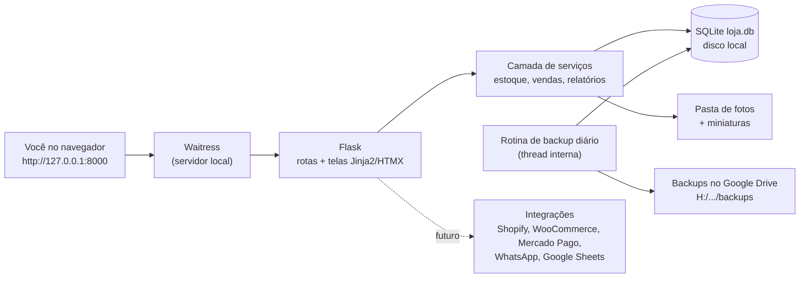

# Etapa 1 – Arquitetura do Sistema de Gestão da Loja Itamarandiba

> **Status:** Etapa 1 concluída (arquitetura). Próxima etapa: design visual das telas (Open Design) e depois a implementação.
> **Diagrama do banco de dados:** [modelo-dados.html](diagramas/modelo-dados.html) (abre no navegador, com zoom e visões guiadas).

---

## 1. Decisões técnicas

| # | Decisão | Escolha | Por quê |
|---|---|---|---|
| D1 | Linguagem | **Python 3.13** (já instalado no seu PC) | Nada novo para instalar manualmente |
| D2 | Framework web | **Flask 3** + templates **Jinja2** | Telas geradas no servidor, sessão de login e proteção CSRF prontas. Mais simples que FastAPI para um portal administrativo (revisão do plano anterior) |
| D3 | Interatividade | **HTMX** (filtros e buscas sem recarregar a página) | Busca instantânea sem precisar de um app JavaScript complexo |
| D4 | Banco de dados | **SQLite** em modo WAL, chaves estrangeiras ligadas | Arquivo único, sem servidor, sem configuração |
| D5 | Acesso ao banco | **SQLAlchemy 2** + migrações versionadas próprias | Ao migrar para hospedagem, troca-se SQLite por PostgreSQL mudando 1 linha |
| D6 | Servidor | **Waitress** em `http://127.0.0.1:8000` | Servidor estável no Windows; escuta só na sua máquina |
| D7 | Inicialização | **`INICIAR-LOJA.bat`** (duplo clique) | Na 1ª vez cria o ambiente `.venv` e instala tudo sozinho; depois só abre o servidor e o navegador |
| D8 | Dinheiro | Guardado em **centavos (inteiro)** | Sem erros de arredondamento em margens e totais |
| D9 | Gráficos | **Chart.js** salvo localmente | Funciona sem internet |
| D10 | Imagens | **Pillow** gera miniatura automática | Listas leves e rápidas |
| D11 | Excel/CSV | **openpyxl** + `csv` | Importar e exportar produtos, vendas, relatórios |
| D12 | Senha | **scrypt** (biblioteca padrão do Python) | Hash forte, sem dependência extra |

### ⚠️ Decisão pendente – onde fica o arquivo do banco (D13)

O Google Drive (H:) é um disco virtual sincronizado. Durante esta etapa, a ferramenta de diagramas falhou ao gravar no H: por falta de recursos de sistema de arquivos — o mesmo tipo de limitação que pode **corromper um banco SQLite** se o Drive sincronizar o arquivo no meio de uma gravação.

**Recomendação:**
- **Código do sistema:** `H:\Meu Drive\ANTIGRAVITY\loja-itamarandiba-gestao\` (como pede sua regra de projetos)
- **Banco + fotos em uso:** `C:\Users\alyso\AppData\Local\LojaItamarandiba\` (disco local, seguro)
- **Backups diários:** `H:\Meu Drive\ANTIGRAVITY\loja-itamarandiba-gestao\backups\` (ficam na nuvem automaticamente)

O caminho fica configurável na tela **Configurações**.

---

## 2. Visão geral dos componentes



**Regra de ouro do código:** as telas nunca mexem no banco direto; tudo passa pela camada de serviços. Isso garante que estoque, custos e auditoria fiquem sempre consistentes — e que as integrações futuras reutilizem as mesmas regras.

---

## 3. Modelo de dados (16 tabelas)

Veja o diagrama interativo: [modelo-dados.html](diagramas/modelo-dados.html)

| Área | Tabelas | Para que serve |
|---|---|---|
| Catálogo | `nicho`, `produto`, `produto_nicho`, `produto_imagem` | Produtos com várias fotos e em vários nichos |
| Compras | `fornecedor`, `compra`, `compra_item` | Pedidos a fornecedores, com frete e impostos rateados no custo |
| Estoque | `movimento_estoque` | Histórico de toda entrada, saída, ajuste e perda |
| Vendas | `cliente`, `venda`, `venda_item` | Vendas por canal (loja, WhatsApp, Instagram, ML, Shopee) |
| Kits | `kit`, `kit_item` | Bundles Básico / Premium / Deluxe |
| Sistema | `usuario`, `configuracao`, `log_auditoria` | Login, preferências e registro de quem alterou o quê |

**Regras de negócio principais**
1. O estoque **nunca é editado à mão**: muda só por movimento (venda, compra recebida, ajuste com motivo).
2. Ao receber uma compra, frete + impostos + outros custos são **rateados** em cada item → custo real.
3. Cada item vendido **congela** preço e custo do momento → margem real nos relatórios, mesmo se o custo mudar depois.
4. Venda cancelada **devolve** o estoque automaticamente.
5. Nada é apagado de verdade (produtos e fornecedores são **inativados**), para não quebrar o histórico.

**Dados iniciais:** os **10 nichos** já entram cadastrados:
1. Presentes Personalizados & Kits Prontos
2. Religioso & Devocional
3. Papelaria Fofa / Studygram & Concurseiros
4. Lembrancinhas de Festas & Eventos
5. Gamer, Geek & Setup de Mesa
6. Pet (Mimos & Identificação)
7. Casa Prática, Cozinha & Achadinhos Virais
8. Beleza Express & Autocuidado
9. Brindes Corporativos & Comércio Local (B2B)
10. Agro / Profissões & Cultura Local

Opcional: importar os fornecedores e produtos já pesquisados (Peining, Marlon, Look China, YiwuGo, etc.) a partir dos documentos 05–10.

---

## 4. Mapa de telas (menu lateral simples)

| Menu | O que você faz ali | Filtros disponíveis |
|---|---|---|
| 🏠 **Início** | Resumo do dia: vendas, lucro, alertas de estoque baixo, aniversariantes | Período |
| 🛒 **Nova Venda** | Tela rápida de caixa: busca produto/kit por nome, SKU ou código de barras | — |
| 📦 **Produtos** | Cadastrar, editar, fotos, nichos, preço com cálculo de margem ao vivo | Nome, SKU, nicho, fornecedor, faixa de preço, faixa de margem, estoque (baixo/zerado/ok), ativo |
| 🏷️ **Nichos** | Gerenciar os nichos e ver desempenho de cada um | Ativo |
| 🎁 **Kits** | Montar bundles com produtos, sugestão de preço e margem | Nicho, nível |
| 🚚 **Compras** | Pedidos a fornecedores, receber mercadoria (entra no estoque) | Fornecedor, status, período |
| 🏭 **Fornecedores** | Contatos, link do site, WhatsApp, prazo, pedido mínimo | Tipo (local/China/marketplace), cidade |
| 📊 **Estoque** | Posição atual, histórico de movimentos, ajustes | Produto, tipo de movimento, período |
| 👥 **Clientes** | Cadastro, histórico de compras, link de WhatsApp | Nome, cidade, aniversário no mês |
| 📈 **Relatórios** | Todos os relatórios (seção 5) | Período, nicho, canal, fornecedor |
| ⚙️ **Configurações** | Tema claro/escuro, senha, backup, dados da loja | — |

**Princípios de usabilidade**
- Cada tela tem **um título claro** e **um botão principal** (ex.: "+ Novo Produto").
- Mensagens sempre em português claro: ✅ "Produto salvo com sucesso" / ⚠️ "Estoque de *Caneca Mágica* abaixo do mínimo (2 de 5)".
- Confirmação antes de qualquer ação que não se desfaz.
- Filtros ficam acima das listas e **lembram a última escolha**.
- Atalhos de teclado na Nova Venda (F2 buscar, F9 finalizar).

---

## 5. Relatórios

| Grupo | Relatórios |
|---|---|
| Vendas | Por dia/semana/mês/ano; por canal; por forma de pagamento; ticket médio; comparação com período anterior |
| Lucro | Margem bruta por produto, nicho, kit e canal; lucro do período; produtos com margem abaixo do alvo |
| Produtos | Curva ABC (o que traz 80% do faturamento); mais vendidos; menos vendidos; parados há X dias |
| Estoque | Valor do estoque (a custo e a preço de venda); estoque baixo/zerado; giro; sugestão de reposição |
| Nichos | Faturamento, lucro e participação de cada um dos 10 nichos; evolução mensal |
| Kits | Kits mais vendidos; quanto os kits aumentaram o ticket médio |
| Compras | Gastos por fornecedor; custo de frete/impostos; histórico de preço de compra por produto |
| Clientes | Melhores clientes; recorrência; clientes sumidos há X dias; aniversariantes |
| Exportação | Qualquer relatório em Excel, CSV ou PDF (PDF otimizado/leve) |

---

## 6. Segurança

- Login com senha (hash **scrypt**) – senha criada no primeiro acesso.
- **Bloqueio temporário** após 5 tentativas erradas (15 min).
- Sessão expira após inatividade (configurável, padrão 2 h).
- Proteção **CSRF** em todos os formulários.
- Servidor escuta apenas em `127.0.0.1` (ninguém da rede acessa).
- Upload aceita só imagens (JPG, PNG, WEBP), com tamanho máximo, renomeadas pelo sistema.
- Consultas ao banco sempre parametrizadas (contra SQL injection).
- **Log de auditoria** de criações, edições, exclusões e logins.

## 7. Backup

- **Automático diário** (e também ao fechar o sistema), usando a cópia segura nativa do SQLite (funciona com o sistema aberto).
- Copia banco + fotos em um `.zip` com data: `backup_2026-11-13.zip`.
- Mantém os últimos **30 diários + 12 mensais** (configurável).
- Botões **"Fazer backup agora"** e **"Restaurar backup"** (com confirmação e backup prévio de segurança).
- Verificação de integridade (`PRAGMA integrity_check`) a cada backup.

## 8. Customizações e integrações

**Na primeira versão**
- Tema claro/escuro, cor de destaque, logo e dados da loja.
- Busca por código de barras (leitor USB funciona como teclado).
- Etiquetas de preço com código de barras / QR Code para imprimir.
- Links de WhatsApp prontos para cliente e fornecedor.
- Alerta no WhatsApp (via sua ponte `whatsapp-alerts`) quando o estoque fica baixo.
- Calculadora de preço de importação (FOB + frete + impostos → custo final → preço sugerido).

**Preparadas para depois** (estrutura de "conectores" desde já)
- Shopify / WooCommerce (sincronizar produtos, estoque e pedidos).
- Mercado Pago / PagSeguro (links de pagamento, Pix).
- Mercado Livre / Shopee (importar pedidos).
- Google Sheets (exportação automática de relatórios).
- Hospedagem na nuvem (SQLite → PostgreSQL).

---

## 9. Estrutura de pastas

```
loja-itamarandiba-gestao/
├── INICIAR-LOJA.bat          ← duplo clique para abrir o sistema
├── requirements.txt
├── README.md                 ← guia de uso
├── docs/
│   ├── 01-ARQUITETURA.md     ← este documento
│   └── diagramas/modelo-dados.html
├── app/
│   ├── __init__.py           ← cria o app Flask
│   ├── config.py             ← caminhos, porta, opções
│   ├── db.py                 ← conexão SQLite + migrações
│   ├── models/               ← tabelas (SQLAlchemy)
│   ├── services/             ← regras: estoque, vendas, compras, relatórios, backup
│   ├── routes/               ← uma pasta por menu (produtos, vendas, ...)
│   ├── templates/            ← telas HTML (Jinja2)
│   ├── static/               ← CSS, ícones, HTMX, Chart.js
│   └── integrations/         ← conectores futuros
├── migrations/               ← scripts de versão do banco
├── seeds/                    ← 10 nichos + dados de exemplo
├── tests/                    ← testes automáticos
└── backups/                  ← backups diários (no Google Drive)
```

---

## 10. Plano das próximas etapas

| Etapa | Entrega | Skills |
|---|---|---|
| ✅ 1. Arquitetura | Este documento + diagrama do banco | `archify`, `brainstorming` |
| ✅ 2. Design visual | Escolha do design system + protótipo das telas principais (Início, Produtos, Nova Venda) | `open-design` |
| ✅ 3. Base do sistema | `INICIAR-LOJA.bat`, login, banco, migrações, backup, menu | `managing-python-dependencies`, `test-driven-development`, `karpathy-guidelines` |
| ✅ 4. Cadastros | Produtos (fotos, filtros), nichos, fornecedores, clientes | `test-driven-development` |
| ✅ 5. Operação | Nova Venda, Compras, Estoque, Kits | `test-driven-development` |
| ✅ 6. Relatórios | Todos os relatórios + exportação | `test-driven-development` |
| ✅ 7. Extras | Etiquetas, WhatsApp, calculadora de importação, importação Excel | — |
| 8. Verificação | Testes completos, teste de restauração de backup, revisão de segurança | `verification-before-completion` |
